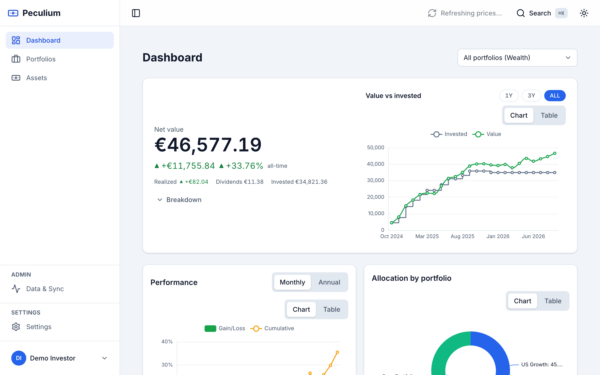
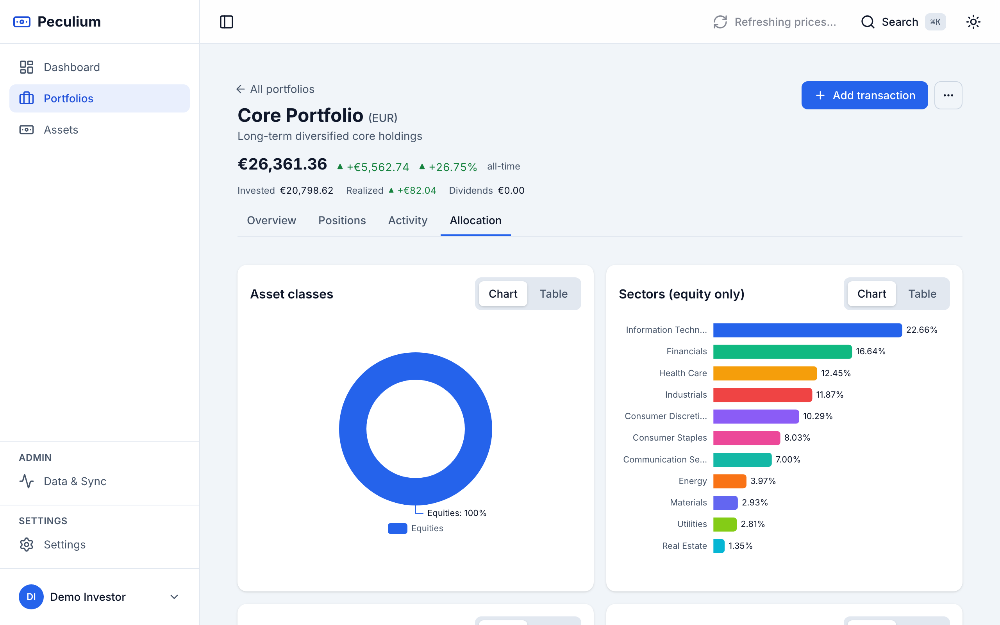
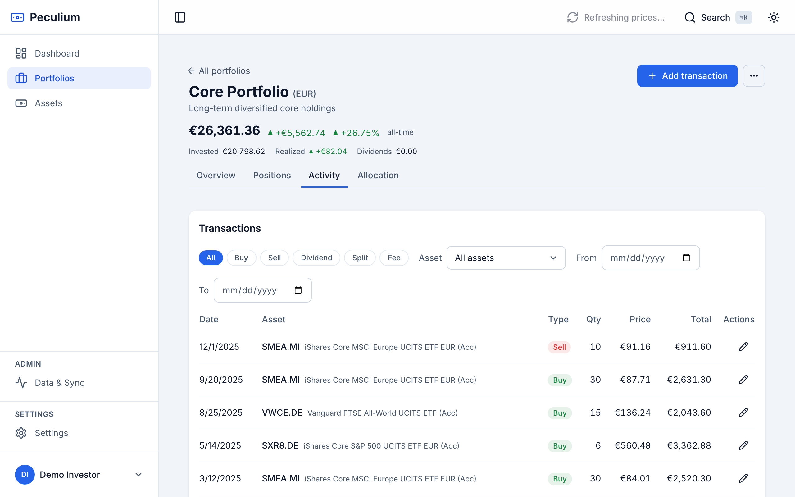
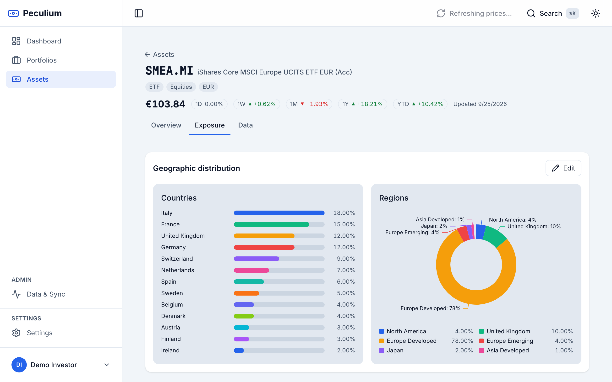
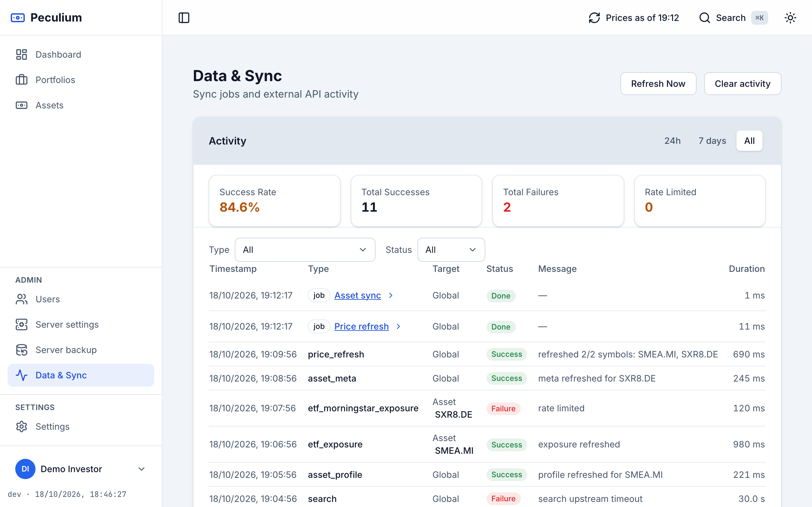
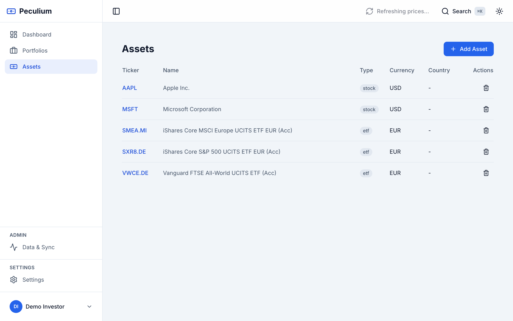

<div align="center">


# Peculium

**Your wealth, self-hosted.**

Self-hosted, multi-user personal finance and investment suite for homelabs.
Track your investments, monitor asset performance, and gain insights into your
financial portfolio — all from your own infrastructure.

[](https://github.com/alv67/peculium/actions/workflows/ci.yml)
[](https://github.com/alv67/peculium/releases)
[](LICENSE)
[](https://github.com/alv67/peculium/stargazers)
[](https://github.com/alv67/peculium/pkgs/container/peculium-backend)

[](https://go.dev)
[](https://svelte.dev)
[](https://www.python.org)
[](https://www.postgresql.org)
[](https://redis.io)
[](https://docs.docker.com/compose/)

[**Website**](https://peculium.dev) · [**Features**](https://peculium.dev/features) · [**Install**](https://peculium.dev/install) · [**Manual**](https://peculium.dev/manual) · [**Releases**](https://peculium.dev/releases)

</div>



*The dashboard: net value, gain/loss, time-weighted performance and allocation,
aggregated in your base currency.*

## Features

- **Multi-user** — Family-friendly with role-based access (owner, admin, editor, viewer)
- **Portfolio management** — Multiple portfolios per user, export/import, ownership enforced on all endpoints
- **Asset tracking** — Stocks, ETFs, bonds, crypto, commodities with auto-complete and sync via Yahoo Finance
- **Asset detail page** — Editable metadata (exchange, ISIN), full price history with backfill, and editable geographic/sector exposure with charts
- **ETF exposure from JustETF and Morningstar** — a Python microservice resolves the ISIN from a ticker and fetches full country/region + GICS sector weights from JustETF (`POST /assets/{id}/fetch-etf-exposure`) and official regions from Morningstar (`POST /assets/{id}/fetch-morningstar-exposure`); each distribution keeps its source and last-update date
- **Transaction history** — Buy, sell, dividends, splits, fees with multi-currency support
- **Dashboard** — Portfolio value, gain/loss, allocation, performance charts, ROI by asset
- **Market prices** — Yahoo Finance with Redis caching, rate-limit/backoff, series materialization, and a **Data & Sync** page where sync jobs and every external API call show up as one activity list
- **Data quality** — Summary exposes staleness / missing-country / missing-sector / missing-FX metrics
- **Self-contained** — Everything runs via Docker/Podman Compose

## Screenshots

<table>
  <tr>
    <td width="50%"><br><sub><b>Allocations</b> — by asset class, sector, country and macro-region.</sub></td>
    <td width="50%"><br><sub><b>Transactions</b> — buy, sell, dividends, splits and fees, with filters and undo.</sub></td>
  </tr>
  <tr>
    <td width="50%"><br><sub><b>Asset detail & exposure</b> — editable metadata, price history and JustETF/Morningstar breakdowns.</sub></td>
    <td width="50%"><br><sub><b>Data & sync</b> — sync jobs and external API activity, with a per-job detail panel and a time window.</sub></td>
  </tr>
  <tr>
    <td width="50%"><br><sub><b>Multi-currency</b> — per-asset currencies aggregated with FX history.</sub></td>
    <td width="50%"></td>
  </tr>
</table>

## Tech Stack

| Layer | Technology |
|-------|-----------|
| Backend | Go 1.27, Chi router, pgx (PostgreSQL), golang-migrate |
| Frontend | SvelteKit (Svelte 5), TypeScript, Tailwind CSS, ECharts |
| ETF metadata | Python 3.14 microservice (FastAPI, requests, BeautifulSoup) — JustETF scraping |
| Database | PostgreSQL 16 |
| Job queue | PostgreSQL 16 + Go worker — market-data sync runs in the background |
| Cache | Redis 7 |
| Container | Docker / Podman + Compose |
| Auth | JWT (access + refresh tokens, rotation) |

## Quick Start

### From source (local build)

```bash
make up
```

Then open http://localhost:3000. This builds the images from the working tree
(`docker-compose.dev.yml`).

### Pull-only install (no local build)

The release stack (`docker-compose.yml`) runs pre-built images published to
GitHub Container Registry (`ghcr.io/alv67/peculium-*`, available from the
v1.0.0 release onward):

```bash
curl -O https://raw.githubusercontent.com/alv67/peculium/main/docker-compose.yml
curl -O https://raw.githubusercontent.com/alv67/peculium/main/.env.example
cp .env.example .env   # optional: pin a version or provide your own secrets
podman-compose up -d
```

Secrets are generated on first boot and stored in the `peculium_secrets` volume
(back it up). Pin `PECULIUM_VERSION` in `.env` to keep the stack on a fixed
release.

> Requires Podman (or Docker) with Compose support.

<details>
<summary><b>Published image tags &amp; test builds</b></summary>

Published image tags:

- `latest` — the most recent release (from a `v*` tag on `main`);
- the release tag (`v1.0.0`, …);
- `develop` — a rolling tag for the latest build dispatched from the
  `develop` branch (unstable, moved on every dispatch);
- `rc-<date>` — a named test/RC build (via the dispatch `version` input);
- `sha-<commit>` — the exact commit of any build, always published for pinning.

None of the test tags (`develop`, `rc-*`) ever move `latest`. Set
`PECULIUM_VERSION` to one of them to run it on an existing database.

To publish a test build from `develop`:

```bash
make publish                        # dispatch from develop; publishes the rolling :develop tag
make publish RC_REF=develop         # explicit ref (this is the default)
make publish RC_VERSION=rc-2026-10-03  # also publish a named tag (rc-<date>) for pinning
```

`gh workflow run` uses the repository default branch unless `--ref` is given, so
`make publish` passes `--ref develop` for you. Without it a manual dispatch would
build `main`, not `develop`. The `RC_VERSION` value is only an extra image tag,
never the ref to build; the reserved names (`latest`, `develop`, `v*`) are
rejected, so a dispatch cannot move a release channel.

Old test builds are pruned at the end of every image publish
(`prune-images.yml`, also runnable on its own as a dry run): `v*`, `latest` and
`develop` are never deleted, and of the remaining tags only the 3 newest older
than 30 days are kept.

</details>

## Testing

```bash
make test-e2e        # End-to-end API tests on an isolated stack (no data pollution)
make test            # Go unit tests (inside the backend container)
cd python-service && python3 -m pytest   # ETF microservice tests
```

Manual API testing against the isolated test stack (port 8081): open
[`tests/api-test.http`](tests/api-test.http) with the VS Code **REST Client** extension
and send the requests in order.

## Project Status

The current release is **v1.1.0** (18 Oct 2026): external data & sync — price,
history, splits and metadata work runs through a background job queue so the
pages never hang; the Data & Sync page merges sync jobs and provider calls into
one activity list with progress, filters and a per-job detail panel; the asset
page reports its price-history completeness and the date of its latest close;
and the running build is shown in the interface.

Active development on the [`develop`](https://github.com/alv67/peculium/tree/develop) branch — see [STATUS.md](STATUS.md) and [PLAN.md](PLAN.md) for the roadmap. The full release history is on the [project website](https://peculium.dev/releases) and in [GitHub Releases](https://github.com/alv67/peculium/releases).

## License

Released under the [MIT License](LICENSE). See [`licenses/`](licenses/) for the
third-party components and their licenses.
